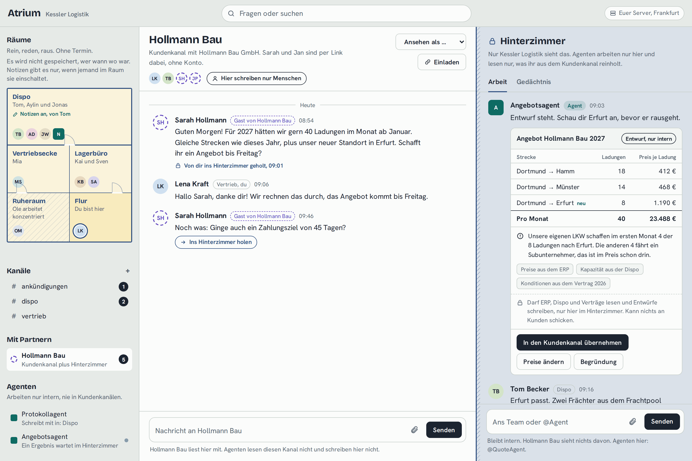
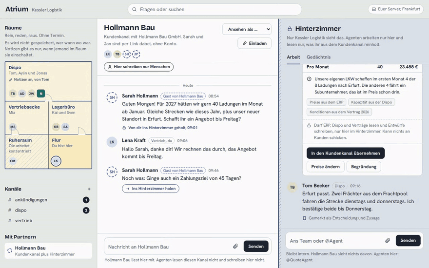
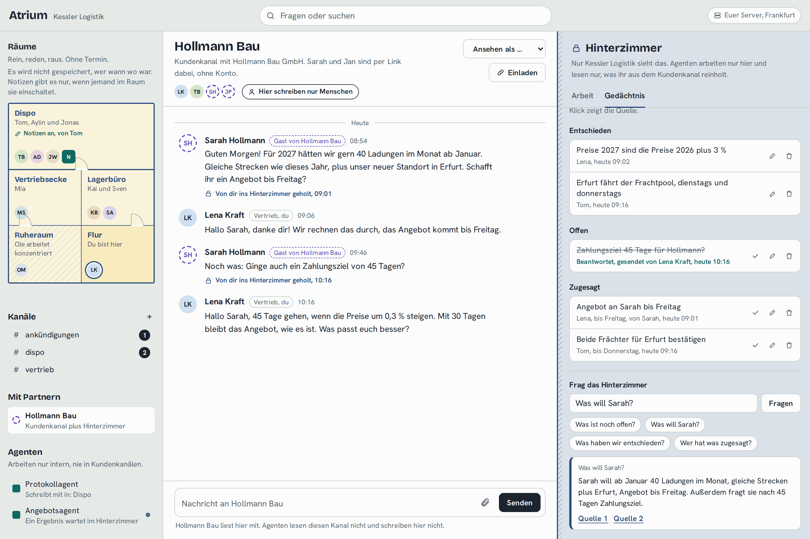
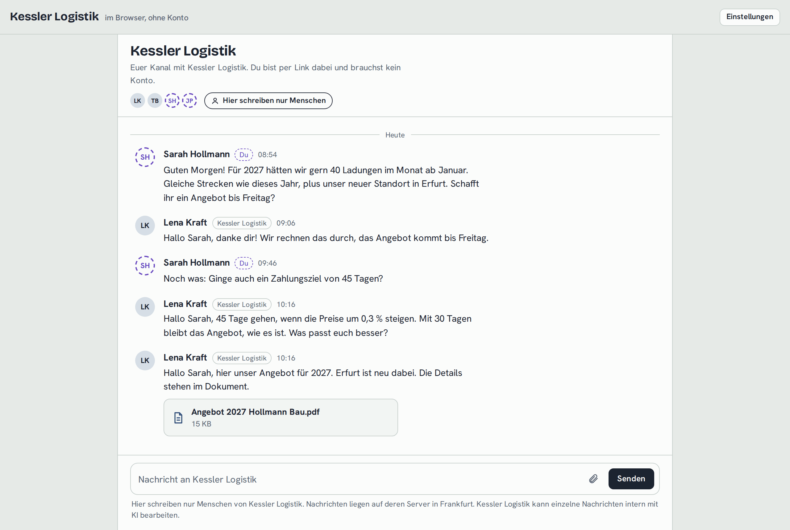
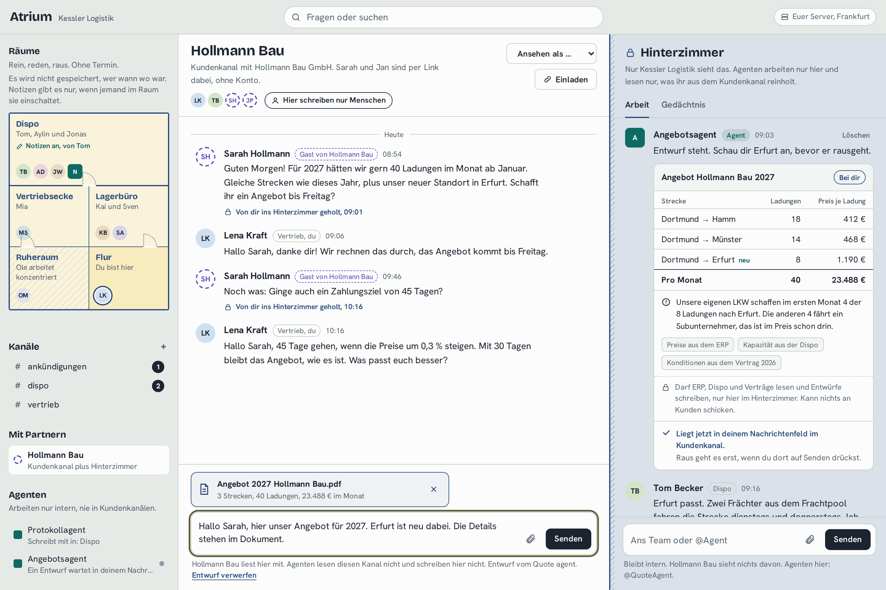
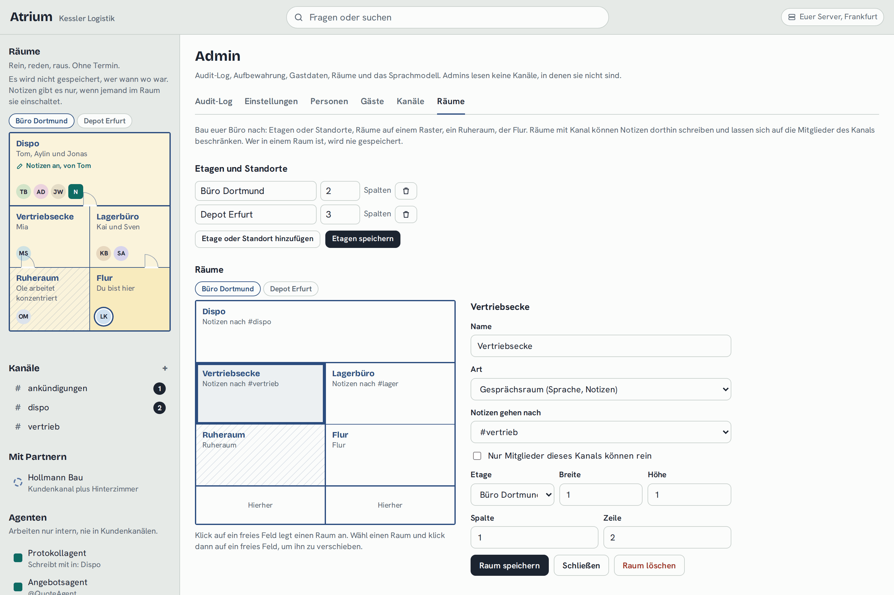
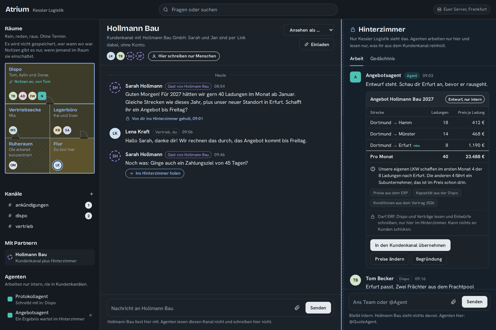
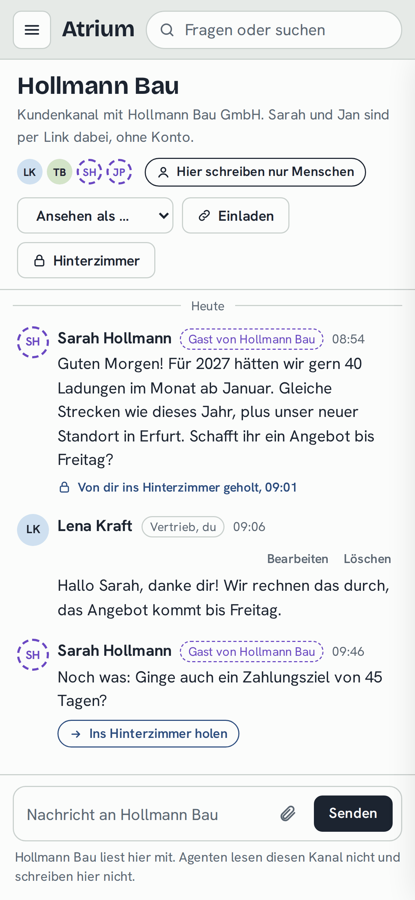
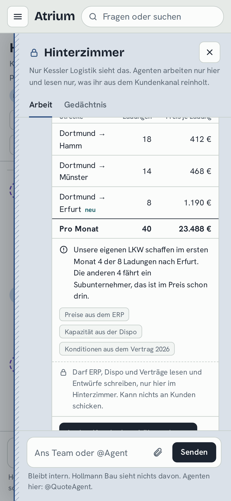

# Atrium

**Firmen-Chat mit euren Kunden drin. KI-Agenten arbeiten nur im Hinterzimmer.**

Atrium ist ein selbst gehosteter Chat für Firmen. Kunden und Partner kommen per Link in einen geteilten Kanal, ohne Konto. Neben jedem geteilten Kanal liegt ein internes Hinterzimmer. Dort arbeiten die Agenten und nirgends sonst: Sie können den Kundenkanal nicht lesen und nichts an Kunden schicken. Was ein Agent sehen soll, holt ein Mensch rein. Was rausgeht, schickt ein Mensch.

[English](README.md) · Deutsch · Lizenz: AGPL-3.0



## So läuft es

1. **Sarah von Hollmann Bau schreibt im geteilten Kanal.** Sie hat von Lena einen Link bekommen und nur ihren Namen eingetippt.
2. **Lena holt genau diese Nachricht ins Hinterzimmer.** Das Hinterzimmer bekommt eine Kopie, das Audit-Log einen Eintrag. Der Rest des Kundenkanals bleibt für Agenten unsichtbar.
3. **`@QuoteAgent` rechnet.** Strecken und Mengen aus dem Vertrag, Preise aus dem ERP, freie Kapazität aus der Dispo. Heraus kommt eine Karte mit Positionen, Summe, Hinweis, Quellen und Begründung.
4. **Lena übernimmt das in den Kundenkanal.** Text und PDF liegen in ihrem Nachrichtenfeld. Raus geht es erst, wenn sie auf Senden drückt, als ihre Nachricht. Sarah sieht nie einen Agenten.



## Was noch drin ist

<table>
<tr>
<td width="50%"><br><b>Gedächtnis.</b> Entscheidungen, offene Fragen und Zusagen aus dem Hinterzimmer, jeweils mit Quelle. Wird die passende Antwort gesendet, ist der Eintrag erledigt. "Frag das Hinterzimmer" antwortet mit Quelle oder sagt, dass es etwas nicht weiß.</td>
<td width="50%"><br><b>Die Sicht des Gasts.</b> Gäste haben eine eigene App und eine eigene API: kein Hinterzimmer, keine Agenten, keine Entwürfe, kein Hinweis aufs Reinholen. "Als Sarah ansehen" zeigt genau das.</td>
</tr>
<tr>
<td><br><b>Agenten entwerfen, Menschen senden.</b> Der Entwurf liegt im Nachrichtenfeld einer Person. Sie kann ihn ändern, das PDF entfernen oder alles verwerfen.</td>
<td><br><b>Räume.</b> Ein Grundriss, in den man zum Reden reingeht, über euren eigenen LiveKit-Server. Admins bauen ihn nach: Etagen oder Standorte, Ruheraum, Flur, Räume nur für ein Team. Wer wann in welchem Raum war, wird nie gespeichert.</td>
</tr>
<tr>
<td><br><b>Hell und dunkel</b>, Deutsch und Englisch. Die Firmensprache gilt auch für Agentenantworten, Kundenentwürfe, das PDF und E-Mails.</td>
<td> <br><b>Auf dem Handy</b> werden Räume und Hinterzimmer zu Schubladen.</td>
</tr>
</table>

Außerdem: Raumnotizen, die nur laufen, wenn jemand im Raum sie einschaltet (lokal mit faster-whisper transkribiert, kein Audio gespeichert), Benachrichtigungen per Browser und E-Mail (in Mails steht, wer wo geschrieben hat, nie was), ein Audit-Log für jedes Reinholen, jeden Entwurf und jeden LLM-Aufruf, Aufbewahrungsfristen je Kanalart, Export und Löschen von Gastdaten.

## Die Wand

Diese Regeln gelten im Backend, nicht nur in der Oberfläche, und zu jeder gibt es einen Test, der nie abgeschwächt wird:

1. Agenten können geteilte Kanäle nicht lesen: nicht über die API, die Suche, Sockets, das Gedächtnis, "Frag das Hinterzimmer" oder den LLM-Kontext.
2. In geteilten Kanälen schreiben nur Menschen. Ein Agent bekommt 403.
3. Eine Kundennachricht kommt nur ins Hinterzimmer, wenn ein Mensch sie reinholt. Das wird protokolliert.
4. Agenten machen nur Entwürfe. Ein Mensch schickt sie ab, als er selbst.
5. Gäste sehen nichts Internes. Sie haben eigene Antwort-Schemas, keine ausgeblendeten Felder.
6. Räume speichern keine Anwesenheit. Notizen laufen nur, wenn jemand sie einschaltet, und alle im Raum sehen das.
7. Jeder LLM-Aufruf wird protokolliert: Agent, Auslöser, Nachrichten-IDs im Kontext, Anbieter, Zeitpunkt.

## Ausprobieren

```sh
git clone https://github.com/gedachtgemacht/atrium.git && cd atrium
cp .env.example .env    # Domain, Postgres-Passwort, LLM-Key, LiveKit-Secret eintragen
docker compose -f deploy/docker-compose.yml --env-file .env up -d --build
docker compose -f deploy/docker-compose.yml exec app python -m atrium.seed --language de
```

Der Seed legt Kessler Logistik mit acht Leuten und dem Kunden Hollmann Bau an und gibt die Anmeldedaten und zwei Gast-Links aus. Für eine echte Installation startest du leer und legst mit `python -m atrium.cli create-admin` den ersten Admin an.

Alles Weitere zu Sprachmodell (Anthropic oder ein eigenes Modell über eine OpenAI-kompatible Schnittstelle), E-Mail, Agenten, Betrieb, Backup und Entwicklung steht im [englischen README](README.md).
