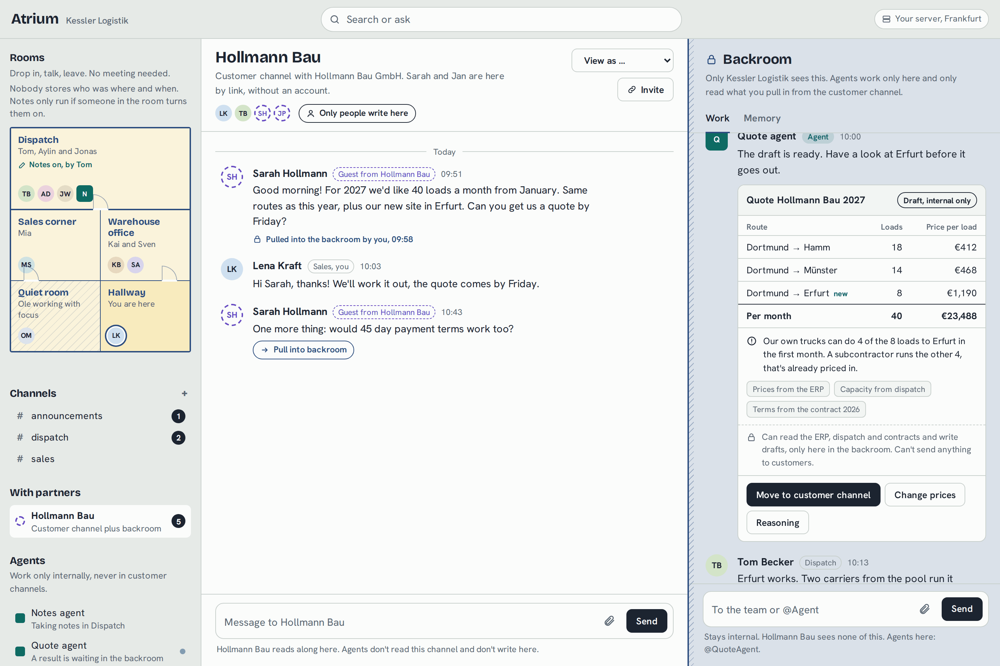
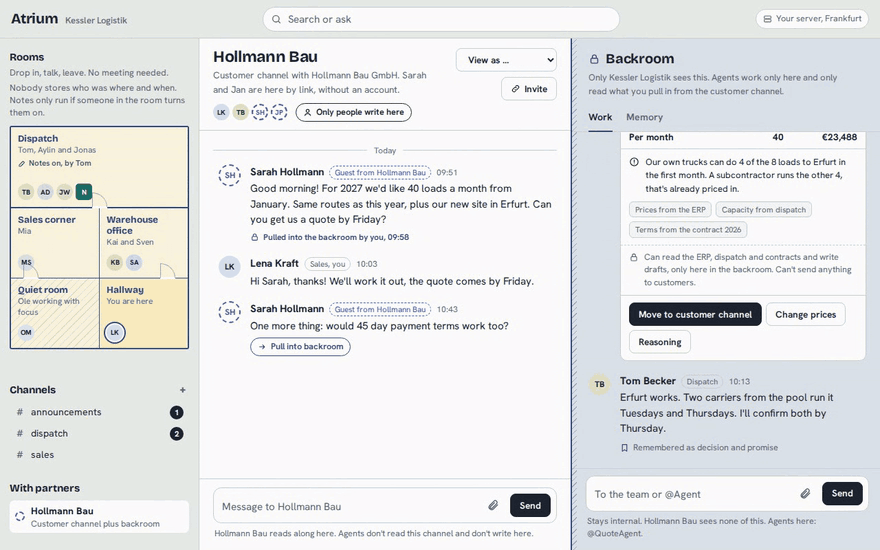
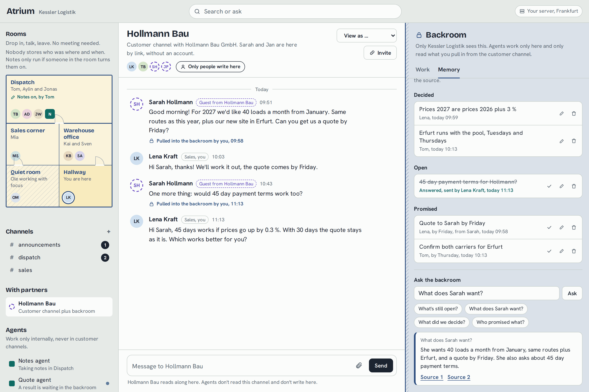
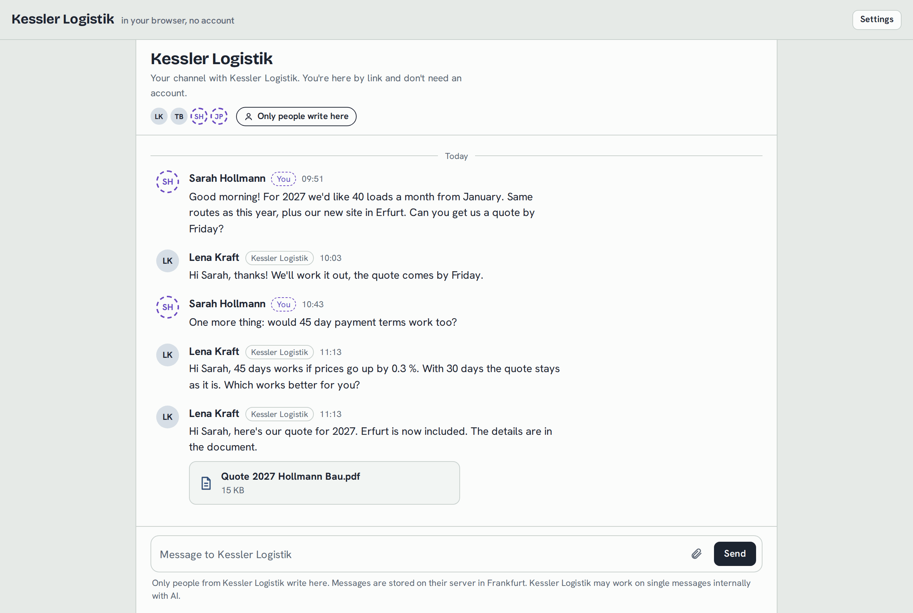
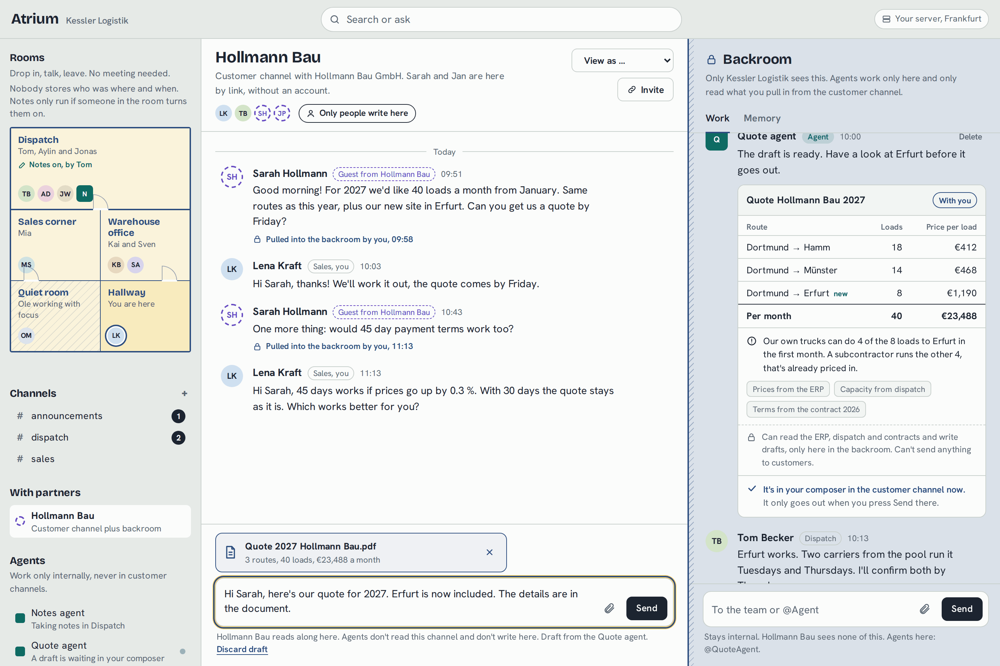
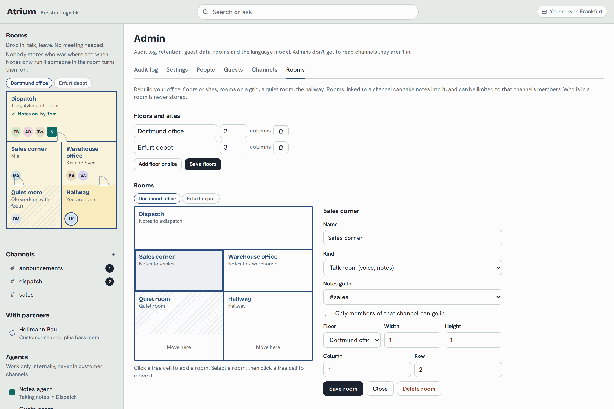
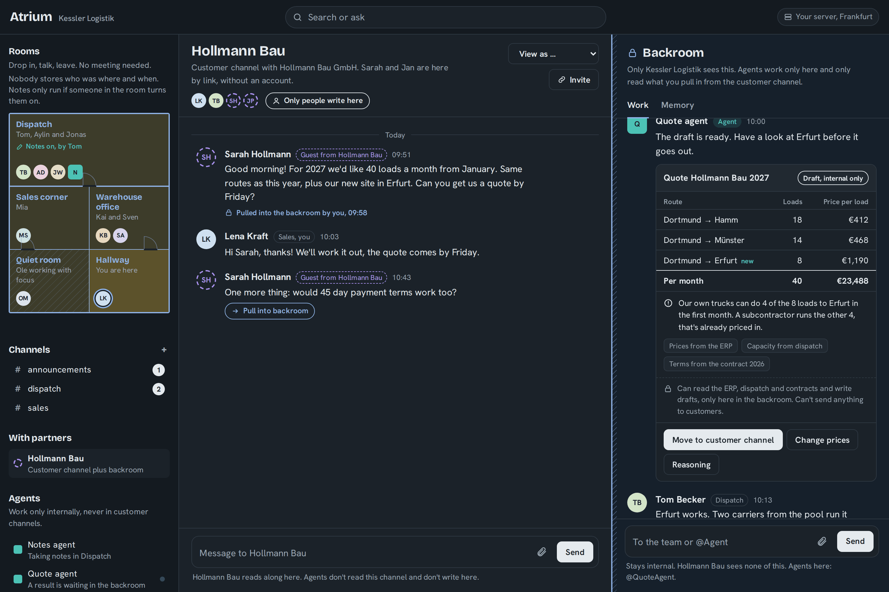
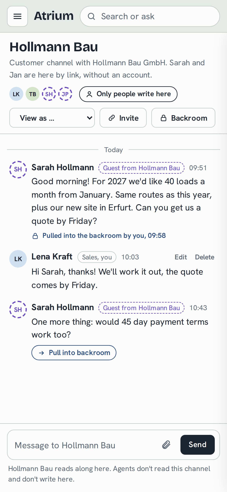
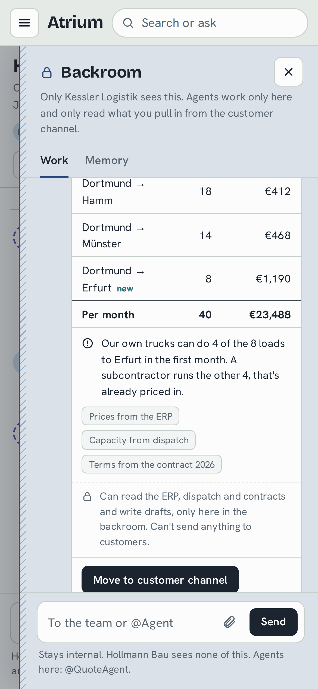

# Atrium

**Team chat with your customers in it. AI agents work only in the backroom.**

Atrium is a self hosted chat for companies. Customers and partners join a shared channel by link, without an account. Next to every shared channel sits an internal backroom. Agents work there and nowhere else: they can't read the customer channel and can't send anything to a customer. A person pulls in what an agent should see, and a person sends what goes out.

English · [Deutsch](README.de.md) · License: AGPL-3.0



## How it works

1. **Sarah from Hollmann Bau writes in the shared channel.** She got a link from Lena and only typed her name.
2. **Lena pulls that one message into the backroom.** The backroom gets a copy, the audit log gets an entry. The rest of the customer channel stays invisible to agents.
3. **`@QuoteAgent` prices it.** Routes and volumes from the contract, prices from the ERP, free capacity from dispatch. The result is a card with lines, total, a note, the sources and the reasoning.
4. **Lena moves it to the customer channel.** Text and PDF land in her composer. It goes out when she presses Send, as her message. Sarah never sees an agent.



## What else is in it

<table>
<tr>
<td width="50%"><br><b>Memory.</b> Decisions, open questions and promises from the backroom, each with its source. Sending the matching reply ticks them off. "Ask the backroom" answers with sources or says it doesn't know.</td>
<td width="50%"><br><b>The guest's view.</b> Guests get their own app and their own API: no backroom, no agents, no drafts, no hint that something was pulled in. "View as Sarah" shows exactly this.</td>
</tr>
<tr>
<td><br><b>Agents draft, people send.</b> The draft sits in one person's composer. They can change it, remove the PDF, or throw it away.</td>
<td><br><b>Rooms.</b> A floor plan you drop into to talk, over your own LiveKit server. Admins lay it out: floors or sites, quiet room, hallway, rooms for one team only. Who was in which room is never stored.</td>
</tr>
<tr>
<td><br><b>Light and dark</b>, English and German. The company language also sets agent replies, customer drafts, the PDF and emails.</td>
<td> <br><b>On the phone</b> the rooms and the backroom become drawers.</td>
</tr>
</table>

Also in it: room notes that only run when someone in the room turns them on (transcribed locally with faster-whisper, audio never stored), notifications by browser and email (emails say who wrote where, never what), an audit log of every pull, draft and LLM call, retention per channel type, guest data export and deletion.

## The wall

These rules hold in the backend, not just in the UI, and each one has a test that is never weakened:

1. Agents can't read shared channels: not through the API, search, sockets, memory, "Ask the backroom" or LLM context.
2. Only people write in shared channels. An agent gets 403.
3. A customer message reaches the backroom only when a person pulls it in. That is logged.
4. Agents only make drafts. A person sends them, as themselves.
5. Guests see nothing internal. They have their own response schemas, not hidden fields.
6. Rooms store no presence. Notes only run when someone turns them on, and everyone in the room sees it.
7. Every LLM call is logged with agent, trigger, the message ids in its context, provider and time.

The canary test puts `KANARIE-7f3a` into a customer channel, runs every agent path against a recording fake LLM and fails if the text shows up anywhere before a person pulls it in. Details in [CLAUDE.md](CLAUDE.md) and [docs/PLAN.md](docs/PLAN.md).

Built with FastAPI, PostgreSQL, Svelte 5, LiveKit and faster-whisper. The language model is Anthropic's API or any OpenAI compatible endpoint you run yourself.

## Run it on a server

Needs Docker with Compose (or Podman with podman-compose), a domain pointing to the server, and ports 80, 443, 7881/tcp and 50000–50100/udp open. Behind another proxy, set `HTTP_PORT`/`HTTPS_PORT` and `ATRIUM_PUBLIC_URL`.

```sh
git clone https://github.com/gedachtgemacht/atrium.git && cd atrium
cp .env.example .env          # set ATRIUM_DOMAIN, POSTGRES_PASSWORD, the LLM key, the LiveKit secret
docker compose -f deploy/docker-compose.yml --env-file .env up -d --build
```

Create the first account (or load the demo data):

```sh
# demo company with eight people and the customer Hollmann Bau (--language de for German)
docker compose -f deploy/docker-compose.yml exec app python -m atrium.seed
```

The seed prints the sign-in emails (password `atrium-demo`, or set `ATRIUM_SEED_PASSWORD`) and two guest links.

For a real installation start empty and create the first admin; everything else happens under **Admin**:

```sh
docker compose -f deploy/docker-compose.yml exec app python -m atrium.cli create-admin \
  --org "Your Company" --location Frankfurt --email you@example.com --name "Your Name"
```

### Language model

Set in `.env`; admins can switch between configured providers under **Admin → Settings**.

- Anthropic API (default): `ATRIUM_LLM_PROVIDER=anthropic`, `ATRIUM_ANTHROPIC_API_KEY`, `ATRIUM_LLM_MODEL`.
- Self hosted, OpenAI compatible (vLLM, Ollama, llama.cpp server): `ATRIUM_LLM_PROVIDER=openai_compat`, `ATRIUM_OPENAI_COMPAT_BASE_URL`, `ATRIUM_OPENAI_COMPAT_MODEL`. For thinking models set `ATRIUM_OPENAI_COMPAT_REASONING=none` to keep answers fast.

Every LLM call shows up in **Admin → Audit log** with the agent, trigger, the ids of the messages in its context, provider and time.

### Email

Set `ATRIUM_SMTP_*` in `.env`. Without SMTP settings mails land in `data/outbox/` as `.eml` files, handy for testing. Guest emails carry a sign-in link valid for 7 days and a one-click unsubscribe link.

### Agents

Agents are YAML files in `agents/`. The `tools` list is all an agent can use. The tools in `backend/atrium/agents/tools/` talk to company systems through adapters (`ErpAdapter`, `DispatchAdapter`, `ContractsAdapter`); V1 ships mocks with demo data. Replace them in `atrium/state.py` with adapters to your own systems.

### Operation

- **Backup:** the database and the `data` volume (uploads, generated PDFs, whisper models).
  ```sh
  docker compose -f deploy/docker-compose.yml exec db pg_dump -U atrium atrium | gzip > atrium-$(date +%F).sql.gz
  docker run --rm -v atrium_data:/data -v "$PWD":/out alpine tar czf /out/atrium-data-$(date +%F).tgz -C /data uploads
  ```
  Restore: `gunzip -c dump.sql.gz | docker compose … exec -T db psql -U atrium atrium`, and unpack the archive into the volume.
- **Updates:** `git pull && docker compose -f deploy/docker-compose.yml --env-file .env up -d --build`. Migrations run on start.
- **Retention:** Admin → Settings. Customer channels, internal channels, audit log and expired guests each get their own number of days. Runs daily; "Apply retention now" runs it at once.
- **Guest data:** Admin → Guests exports everything stored about a guest as JSON, or deletes the guest with their messages, backroom copies and files.
- **Logs:** the app, Caddy and LiveKit are configured not to log requests, so no log ties a person to a room.
- **Scale:** the app runs as a single process on purpose (presence lives in memory). That covers one company with a few hundred people.

## Develop

Requirements: Python 3.12 with [uv](https://docs.astral.sh/uv/), Node 20+, Postgres 17.

```sh
podman run -d --name atrium-pg -e POSTGRES_USER=atrium -e POSTGRES_PASSWORD=atrium -e POSTGRES_DB=atrium -p 127.0.0.1:55432:5432 docker.io/library/postgres:17
podman exec atrium-pg psql -U atrium -c "CREATE DATABASE atrium_test" -c "CREATE DATABASE atrium_e2e"
podman run -d --name atrium-livekit --network host docker.io/livekit/livekit-server:v1.9 --dev --bind 127.0.0.1   # optional, voice

cd backend && uv sync --extra notes && uv run python -m atrium.seed --reset
uv run uvicorn atrium.main:app --reload --no-access-log        # http://localhost:8000
cd ../frontend && npm install && npm run dev                   # http://localhost:5173 with hot reload
```

`.env` in the repository root (see `.env.example`); for local voice use `ATRIUM_LIVEKIT_URL=ws://localhost:7880`, key `devkey`, secret `secret`. For a local model, Ollama works: `ATRIUM_LLM_PROVIDER=openai_compat`, `ATRIUM_OPENAI_COMPAT_BASE_URL=http://127.0.0.1:11434/v1`.

Tests:

```sh
cd backend && uv run pytest            # unit, flow and wall tests
cd frontend && npx playwright test     # end to end in real browsers
E2E_LIVEKIT_URL=ws://localhost:7880 npx playwright test e2e/voice.spec.ts   # three browsers talking, needs the LiveKit dev server
cd frontend && npm run check           # types
cd frontend && npm run build && npm run check:guest   # the guest bundle carries no internal words
```

The wall tests in `backend/tests/wall/` are never weakened or skipped.

The pictures in this README come from `tools/screenshots/stage.py` (a demo company with a scripted LLM, played through the real API) and `frontend/scripts/screenshots.mjs`.

## Try the mockup flow

Sign in as `lena@kessler.example`, open **Hollmann Bau**, and open Sarah's guest link in a private window.

1. Sarah writes in her window; it shows up live for Lena.
2. At Sarah's first message: **Pull into backroom**, note `@QuoteAgent please price this: 40 loads a month, routes from 2026 plus Erfurt, prices 2026 plus 3 %.` The quote card shows Hamm €412, Münster €468, Erfurt new at €1,190, €23,488 a month.
3. **Change prices**, then **Move to customer channel**: text and PDF land in Lena's composer. **Send**. Sarah sees it as Lena's message.
4. Pull Sarah's payment terms question with `@QuoteAgent calculate the payment terms`. The card works out 45 instead of 30 days with the interest rate from the settings; **Draft a reply in the customer channel**.
5. **Memory** tab: the promise and the question are crossed out once the drafts are sent. Ask "What does Sarah want?".
6. **View as Sarah**: the real guest app, read only, without any trace of the backroom.
7. Rooms: click **Dispatch** in two browsers and talk; **Notes on** makes the notes agent appear as a square and, when switched off, posts a summary in #dispatch.
